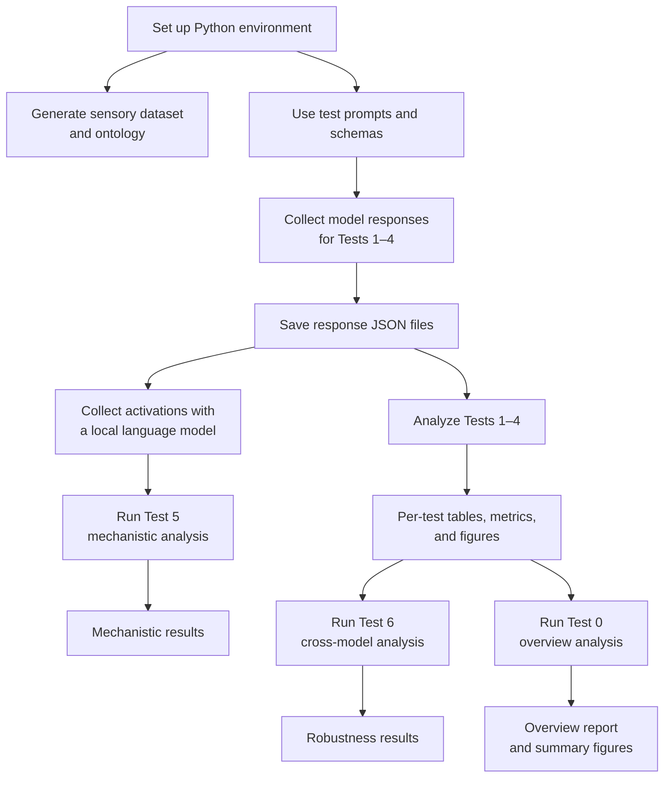

# Empirical Studies in Ontological Creativity of AI


This repository contains notebooks and scripts for empirical studies of the limits of AI systems in ontological creativity, including the analyses reported in the dissertation *Structural Limits of Neural Networks in Ontological Creativity*.

The project combines a multimodal sensory-dataset generator, AI response collection, four empirical analyses, a mechanistic interpretability study, and cross-model robustness analysis.

**Presentation:** [Defense presentation](https://jabe22.github.io/)

## Research workflow



Tests 1–4 analyze collected responses. Test 5 uses response exports as prompts for a local model. Test 6 compares results from Tests 1–4, and Test 0 aggregates those four tests into an overview.

## Studies and notebooks

Test 0 aggregates the results from Tests 1–4 in the [overview notebook](research/test0_overview/overview-analysis.ipynb). The six empirical and supporting studies are:

<table>
  <tr>
    <td align="center"><a href="research/test1_ontological-innovation/test1_analysis.ipynb"><br><strong>Test 1 · Ontological Innovation</strong></a><br>Novelty of proposed sensory modalities</td>
    <td align="center"><a href="research/test2_epistemic-agency/test2_analysis.ipynb"><br><strong>Test 2 · Epistemic Agency</strong></a><br>Framework-transcending research questions</td>
    <td align="center"><a href="research/test3_theory-generation/test3_analysis.ipynb"><br><strong>Test 3 · Theory Generation</strong></a><br>Novelty and traceability of generated theories</td>
  </tr>
  <tr>
    <td align="center"><a href="research/test4_category-recognition/test4_analysis.ipynb"><br><strong>Test 4 · Category Recognition</strong></a><br>Category mistakes and alternative framings</td>
    <td align="center"><a href="research/test5_mechanistic/test5_mechanistic-analysis.ipynb"><br><strong>Test 5 · Mechanistic Interpretability</strong></a><br>Internal activations and model representations</td>
    <td align="center"><a href="research/test6_cross_model/test6_cross-model-analysis.ipynb"><br><strong>Test 6 · Cross-Model Robustness</strong></a><br>Stability of findings across models</td>
  </tr>
</table>

Test-specific response prompts and schemas for Tests 1–4 are stored in each test directory under `prompts/`. Analysis notebooks generally write tables and metrics to `results/data/` and figures to `results/figures/`.

## Setup

Run commands from the repository root.

```bash
python -m venv .venv
source .venv/bin/activate
python -m pip install --upgrade pip
python -m pip install -r requirements.txt
```

The repository does not pin a Python version. Use a Python environment compatible with the packages listed in [`requirements.txt`](requirements.txt). GPU support is optional; the activation-collection step may benefit from a GPU, depending on the selected model.

## Generate the sensory dataset

Open and run [`dataset-generation.ipynb`](research/data/notebooks/dataset-generation.ipynb):

```bash
jupyter notebook research/data/notebooks/dataset-generation.ipynb
```

The notebook generates 7,000 examples: 5,000 training, 1,000 validation, and 1,000 test examples. Each example contains 60 timesteps and 359 features per timestep across eight modalities. From the repository root, generated files are written under `data/`:

- `multimodal_sensory_train.npz`
- `multimodal_sensory_val.npz`
- `multimodal_sensory_test.npz`
- `ontology.json`

The modality dimensions are visual (140), auditory (128), tactile (32), olfactory (10), gustatory (5), proprioceptive (30), vestibular (6), and interoceptive (8).

## Collect AI responses

Response collection is optional if you already have response exports. To query models, create a local `.env` file in the repository root. Do not commit API keys.

```dotenv
OPENROUTER2_API_KEY=your_openrouter_key
# Only needed when using the Perplexity provider:
PERPLEXITY_API_KEY=your_perplexity_key
```

List the models configured in the collector, then choose model names for the provider you intend to use:

```bash
python research/data/scripts/collect_ai_responses.py --provider openrouter --list-models
```

For example, to collect responses for all four empirical tests using the currently configured OpenRouter model identifiers:

```bash
python research/data/scripts/collect_ai_responses.py \
  --provider openrouter \
  --test all \
  --models gpt-5.2,claude-sonnet-5,gemini-3.1-pro-preview \
  --n-samples 24
```

This makes external API calls, which may incur costs and are subject to provider availability and rate limits. The collector saves per-sample JSON files and an `all_responses.json` export in each test's `ai_responses/` directory. The prompt and response schema are loaded from that test's `prompts/` directory.

## Run the analyses

After response collection, open the relevant notebook from the table above in Jupyter. Tests 1–4 can be analyzed independently once their response data is available. Test 6 requires the result files from Tests 1–4. Test 0 also requires the result files from Tests 1–4.

### Mechanistic analysis (Test 5)

Test 5 requires response exports for Tests 1–4. It runs a local Hugging Face causal language model over prompts from those exports and saves activation artifacts under `research/data/activations/`.

```bash
python research/data/scripts/collect_activations.py \
  --model-name mistralai/Mistral-7B-v0.1 \
  --per-test-limit 4 \
  --max-new-tokens 64 \
  --save-attentions
```

Then run [`test5_mechanistic-analysis.ipynb`](research/test5_mechanistic/test5_mechanistic-analysis.ipynb). Model downloads, memory needs, and access requirements depend on the selected Hugging Face model; omit `--save-attentions` if attention tensors are not needed.

## Repository map

```text
research/
├── data/
│   ├── notebooks/       # Dataset generation
│   ├── scripts/         # Response, activation, and literature utilities
│   ├── setups/          # Shared model, threshold, and visualization helpers
│   └── ...              # Ontology and research data
├── test0_overview/      # Aggregate analysis for Tests 1–4
├── test1_ontological-innovation/
├── test2_epistemic-agency/
├── test3_theory-generation/
├── test4_category-recognition/
├── test5_mechanistic/
└── test6_cross_model/
```

## License and issues

The project is distributed under the [MIT License](LICENSE). For questions, bug reports, or reproducibility issues, please [open a GitHub issue](https://github.com/JABE22/PhD/issues).
